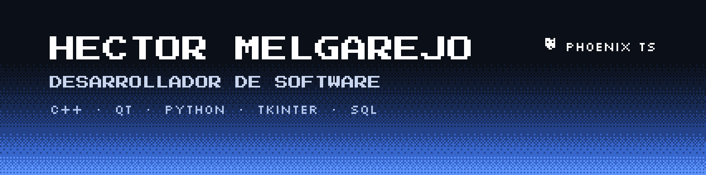

  

Desarrollo **software de escritorio y aplicaciones conectadas a la nube**, con foco en que sean rápidas, confiables y fáciles de usar, incluso en computadoras de pocos recursos.

- Desarrollador de software y **técnico en informática**: conozco tanto el programa como la computadora donde corre.
- Fundador de **Phoenix TS**, donde creo y mantengo productos de software para negocios.
- Me enfoco en el **rendimiento**, la **confiabilidad de los datos** y las interfaces simples para quien las usa todos los días.
- Desde Colombia.

- Desarrollo de software a medida: aplicaciones de escritorio, bases de datos e integración con la nube.
- Sistemas de gestión para empresas y comercios.
- Instalación, soporte y mantenimiento de computadoras.

  

**[Phoenix POS](https://github.com/HectorMelgarejo-PY/phoenix-pos-showcase)**: sistema de punto de venta para comercios. Ventas con lector de código de barras, inventario, compras y proveedores, reportes con exportación a Excel, usuarios con permisos y sincronización en la nube.

<table>
  <tr>
    <td></td>
    <td></td>
  </tr>
  <tr>
    <td></td>
    <td></td>
  </tr>
</table>

| | |
|---|---|
| **Stack** | C++17 · Qt 6 · SQLite · Supabase (PostgreSQL) |
| **Rendimiento** | Probado con 100.000 productos y 500.000 ventas |
| **Confiabilidad** | Copias automáticas, recuperación de bases dañadas, pruebas de corte de luz y disco lleno |
| **Calidad** | Batería de pruebas automáticas en cada compilación |
| **Versión** | 1.0.6, con instalador `.msi` para Windows 10 y 11 |

  <a href="https://github.com/HectorMelgarejo-PY/phoenix-pos-showcase"><b>Ver Phoenix POS →</b></a>

  

  <picture>
    <source media="(prefers-color-scheme: dark)" srcset="https://raw.githubusercontent.com/HectorMelgarejo-PY/HectorMelgarejo-PY/output/serpiente-oscuro.svg">
    
  </picture>

